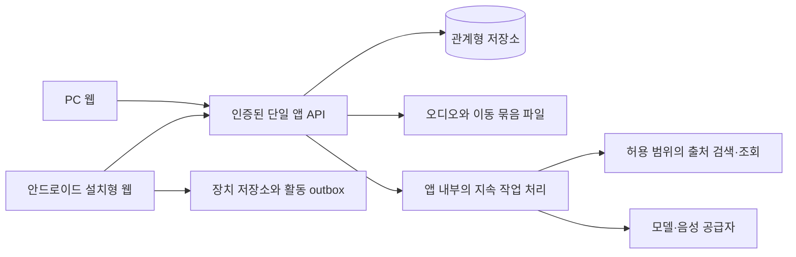

# 아키텍처 제안과 남은 기술 선택

기준일: 2026-10-13. 상태: 제안. 제품 요구가 기술보다 우선한다.
확정 환경: 개인 PC+안드로이드, 준비한 이동용 자료의 offline 사용.

## 최소 구조 제안

첫 구현은 단일 앱 서비스와 관계형 저장소로 유지하는 것이 추천이다. 작업 기록과 재시도 상태는 DB에 남기고 외부 호출은 트랜잭션 밖에서 한다. 별도 microservice·message broker·vector/graph DB·임의 실행 runner는 현재 필요 근거가 없다.

## 웹 앱을 먼저 검토하는 이유

PC와 안드로이드가 같은 콘텐츠·기록을 쓰고, 준비한 자료를 장치에 저장하는 범위를 비교적 작은 구성으로 다룰 수 있다. Service Worker·Cache·IndexedDB·실제 오디오 재생의 지원 범위를 조사하고 목표 기기에서 확인해야 한다. 설치형 웹이라고 영구 저장이나 앱 종료 후 계속 재생을 보증하지 않는다.

기본 음성 재생이 실제 목표 기기에서 요구를 충족하지 못하면 음성 부분의 native 보완을 검토한다. 모든 화면을 처음부터 native 앱으로 만들자는 결정은 아니다.

## 서버 스택 선택 후보

| 후보 | 장점 | 부담·검증할 것 |
|---|---|---|
| React 기반 웹 + Spring Boot + PostgreSQL | v1의 저장·트랜잭션·테스트 기반을 선별 재사용 가능 | Java/웹 두 환경, 배포·메모리·운영비 확인 |
| TypeScript 중심 웹·서버 + 관계형 DB | 언어·배포 구성을 줄일 가능성 | 데이터·작업·권한·중복 처리와 테스트 기반을 새로 검증 |
| 특정 serverless 플랫폼 | 작은 개인 트래픽의 운영 편의 가능성 | 작업 시간·파일·DB·인증 제약과 종속성 확인 |

현재 추천은 React·TypeScript PWA + Spring Boot 단일 앱 + PostgreSQL이다. 사용자 규모와 비용이 핵심 제약이 아니고, 확인한 저장·테스트 기반을 재사용하며 AWS/개인 노트북 사이에 옮기기 쉬운 구성이라는 판단이다. 사용자 직접 스택 선택은 아니므로 ADR은 제안 상태다. 실제 도구chain·배포 자원을 확인해 반박 근거가 있으면 대안을 제시한다. 기능·API 의미와 개인 학습 기록은 플랫폼에 종속되지 않게 한다.

## 지속 작업

API는 원문·대상 버전·작업 상태를 저장하고 반환한다. 앱 내부 worker가 짧은 lease로 작업을 맡고 외부 호출을 수행한 뒤 검증된 결과를 짧은 트랜잭션으로 적용하는 방식이 후보다.

현재 attempt/lease token과 기대 대상 버전으로 결과 적용 권한을 확인한다. 파일 검증·지속 저장과 DB 참조가 모두 준비된 결과만 노출한다. 프로세스 종료·중복 실행·timeout·취소·사용자 방향 변경을 다룬다. 단순 동기 호출로 시작하더라도 재시작 때 비용·작업·학습 상태가 없어지는 것을 첫 실제 사용에 노출하지 않는다. provider 호출의 exactly-once를 보증하지 않는다.

## 파일과 offline

서버 파일은 소유권 검사 후 접근한다. 이동 묶음은 특정 콘텐츠·오디오 버전의 manifest다. 기기는 필요한 파일 검증이 끝난 묶음만 offline 완료로 표시한다. 저장소 접근 실패·quota·eviction은 제품 오류 상태로 다룬다.

Background Sync에만 의존하지 않고 앱 열기·연결 회복 때 outbox를 비운다. 실제 Android에서 설치·비행기 모드·잠금화면·다른 앱 전환·복귀를 검사한다.

## 기술 결정 기록 기준

저장·계정·배포·작업 실행·offline 동기화·AI 비용 한도는 이유와 대안·실패·되돌림을 기록한다. 공급자·버전·한도 값은 공개 공식 문서와 선택 시점의 조건을 확인한다. 기능과 운영에 효과가 없는 기술은 학습 목적으로 도입하지 않는다.
